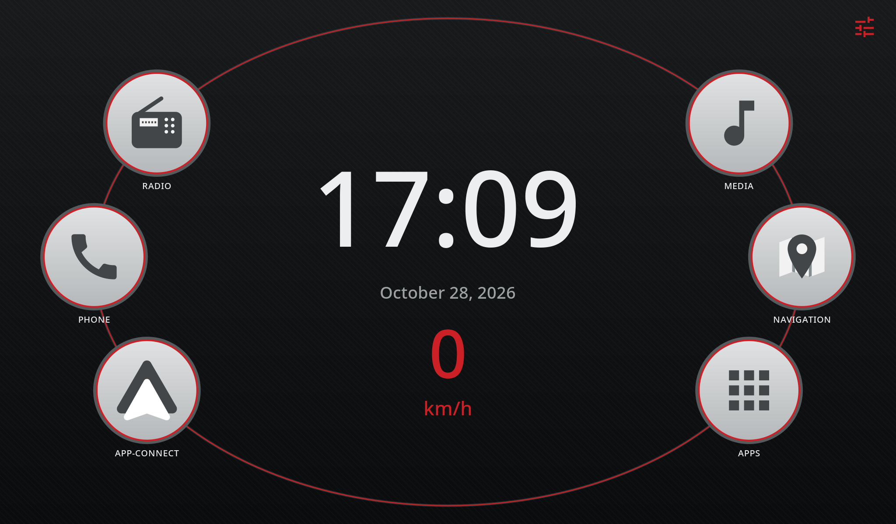
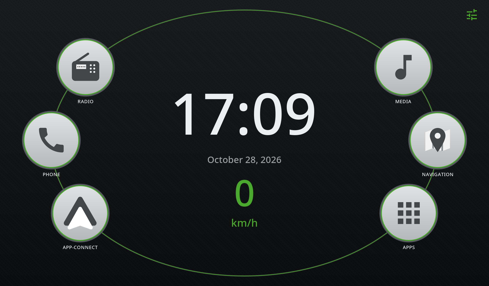

# rns-launcher

A personal Android launcher for my aftermarket VW Golf VI head unit, kept here on GitHub for my
own use. Kotlin, classic Views, no Google Play Services.

The dashboard follows the factory VAG unit RNS, in two brand skins: Volkswagen red
(default) and Škoda green — switchable under **Settings → Theme**.

Each of the six home keys can be renamed and given any icon from a built-in set
under **Settings → Keys and labels**. The captions are the user's own, so only an
English default ships and they are not translated.

## Screens

| Volkswagen red (default) | Škoda green |
| --- | --- |
|  |  |

## Credits

A fork of [Dashline](https://github.com/metehankaygsz/dashline) by Metehan Kaygısız,
licensed under the GNU GPL v3 — see [LICENSE](LICENSE).

The icon set offered for the home keys comes from
[Material Icons](https://github.com/google/material-design-icons), Apache-2.0;
each `ic_key_*.xml` keeps the notice.

